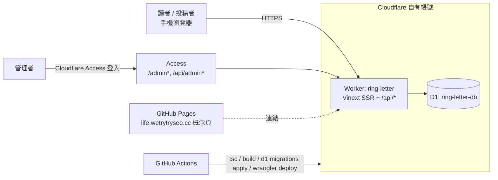

# Ring letter — 第一版前後端架構規劃（MVP 打通）

> 2026-11-06 · 草案，待確認「待決事項」後開工

## 1. 現況盤點

| 部分 | 內容 | 問題 |
|---|---|---|
| 根目錄 `index.html` + `CNAME` | GitHub Pages 靜態概念說明頁，網域 `life.wetrytrysee.cc` | 純靜態，無後端 |
| `ring-letter/` | Vinext（Vite 版 Next.js，**beta**）+ React 19，跑在 Cloudflare Workers，資料庫 D1（SQLite）+ Drizzle | 綁在 **OpenAI ChatGPT Sites** 託管（`.openai/hosting.json` 的 `project_id` 屬於 tom82523），我們沒有部署權 |
| 前端 `app/page.tsx` | 單頁：首頁 / 投稿（past/present）/ 我的片段 / 審閱；`components/match-experience.tsx` 隨機試讀（靜態資料） | 程式碼高度壓縮，難維護；不阻擋 MVP |
| 後端 `app/api/letter/route.ts` | 單一端點，`action` 分派：`session / start / submit / withdraw / erase / feedback / moderate`，GET `?action=mine|admin` | 管理者驗證靠 `oai-authenticated-user-email` header（Sites 平台注入）→ **離開 Sites 後可被偽造，必須換掉** |
| DB | `sessions`、`stories`、`feedback`、`writing_attempts`；遷移在 `drizzle/` | `cleanup()` 會刪 30 天前**所有**資料，包含已核准的公開故事 |
| Sites 腳手架 | `scripts/`、`lib/connector*`、`worker/index.ts` 的 connector 綁定、`app/chatgpt-auth.ts`、vite 的 `sites()` / `connectorPreview()` plugin | 自架用不到，造成建置依賴與複雜度 |

**結論：程式本身已是可運作的全端 MVP；「打通第一版」的核心工作是脫離 Sites、改由我們自己的 Cloudflare 帳號部署，並換掉管理者驗證。**

## 2. 目標架構（建議：Cloudflare 自有帳號）

| 層 | 第一版選擇 | 理由 |
|---|---|---|
| 前端 | 沿用 Vinext + React，SSR 於同一個 Worker | 不重寫，改動最少 |
| 後端 API | 沿用 `/api/letter`，只抽出 `lib/auth.ts`、`lib/session.ts` | 先打通，REST 拆分放 v1.1 |
| 資料庫 | Cloudflare D1，`wrangler d1 migrations apply`（`migrations_dir: "drizzle"`） | 現有 SQL 遷移可直接沿用 |
| 管理者驗證 | Cloudflare Access（Zero Trust 免費 ≤50 人）保護 `/admin*`、`/api/admin*`；Worker 驗 `Cf-Access-Jwt-Assertion` JWT + `ADMIN_EMAILS` 白名單 | 取代可偽造的 header；不用自寫登入 |
| 匿名使用者 | 保留現行 30 天 HttpOnly session cookie（只存 SHA-256） | 已實作且合理 |
| 網域 | App：`letter.wetrytrysee.cc`（Worker custom domain）；概念頁維持 `life.wetrytrysee.cc` | 兩者互不影響 |
| CI/CD | GitHub Actions：PR 跑 tsc + build + `tests/api.mjs`；main 合併後 migrate + deploy | 一鍵可重現 |
| 秘密 | `CLOUDFLARE_API_TOKEN`、`CLOUDFLARE_ACCOUNT_ID`（GH secrets）；`ADMIN_EMAILS`、`ACCESS_TEAM_DOMAIN`、`ACCESS_AUD`（wrangler vars） | 不進版控 |

### 備案：自架（office-pc LXD / Docker，Node + SQLite）
Vinext 輸出是 Workers 格式，自架需在正式環境跑 `wrangler dev`（不建議）或改寫成標準 Next.js / Hono + better-sqlite3。工作量大約多 2–3 倍，只在不能用 Cloudflare 時採用。

## 3. API 盤點（第一版維持現狀，只改驗證）

| 方法 | action | 權限 | 用途 |
|---|---|---|---|
| GET | （無） | 公開 | 已核准故事列表（≤100） |
| GET | `mine` | session | 我的片段 |
| GET | `admin` | **管理者** | 待審故事、回饋、寫作指標 |
| POST | `session` | 公開（同源檢查） | 發 session cookie |
| POST | `start` | session | 記錄開始試寫（每日 ≤30） |
| POST | `submit` | session | 投稿（每日 ≤5） |
| POST | `withdraw` / `erase` | session | 撤回單篇 / 刪除全部 |
| POST | `feedback` | session | 回饋（每日 ≤30） |
| POST | `moderate` | **管理者** | 核准 / 拒絕 / 刪除 |

v1 改動：`admin(req)` → `await verifyAdmin(req, env)`（驗 Access JWT）。前端審閱頁的請求路徑若要被 Access 保護，需把管理者 API 移到 `/api/admin`（GET 列表 + POST moderate），其餘不動。

## 4. 實作里程碑

| # | 項目 | 完成定義 |
|---|---|---|
| M0 | 本機基線 | `npm ci`、`npm run dev` 可開；`tests/api.mjs` 通過 |
| M1 | 移除 Sites 依賴 | 刪 connector / chatgpt-auth / sites plugin；新增 `wrangler.jsonc`（D1 binding `DB`）；`.openai/` 移除；build 通過 |
| M2 | 管理者驗證替換 | `lib/auth.ts` 驗 Access JWT；管理者 API 移至 `/api/admin`；本機用 `DEV_ADMIN_EMAIL` 僅限 `import.meta.env.DEV`；測試改寫 |
| M3 | Cloudflare 資源 | 建 D1、套遷移、Access 應用、Worker custom domain；手動 `wrangler deploy` 成功 |
| M4 | CI/CD | GitHub Actions 兩條 workflow（PR 檢查 / main 部署） |
| M5 | 端到端驗收 | 正式網域：投稿 → 管理者核准 → 公開可讀 → 回饋 → 撤回，全部走通 |

## 5. 第一版刻意不做（v1.1+）

- 把 `/api/letter` 拆成 REST 資源路由、重構 `page.tsx`
- 修正 30 天清除會刪掉已核准故事（建議：只清 sessions / 未分享資料，核准內容另訂保留政策）
- `FORM_URL_DISTRESS` / `FORM_URL_ECHO` 外部表單、人工媒合流程
- Turnstile 防濫用、管理者審閱介面改善、危機內容獨立流程
- 從 Vinext beta 換到穩定框架（觀察 beta 穩定度再決定）

## 6. 待決事項

1. **託管**：用我們自己的 Cloudflare 帳號（建議），還是自架？
2. **網域**：`wetrytrysee.cc` DNS 是否已在 Cloudflare？App 子網域用什麼？
3. **既有資料**：Sites 上 D1 的投稿要搬嗎？（只有 30 天保留，且需 tom82523 匯出；建議從空庫開始）
4. **管理者名單**：只有你，還是含 tom82523？
5. **與 tom82523 協作**：目前線上站 `ring-letter-first-light.tom82523.chatgpt.site` 要並行還是停用？
